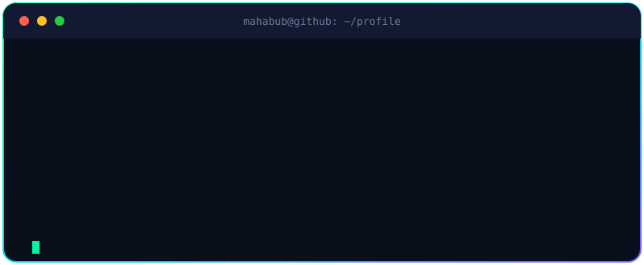
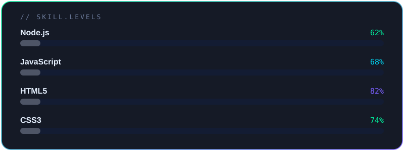

<picture>
  <source media="(prefers-color-scheme: dark)" srcset="./assets/header-white.svg">
  
</picture>

 

 

  

<h2 align="center">⚡ ABOUT ME</h2>

<picture>
  <source media="(prefers-color-scheme: dark)" srcset="./assets/terminal-white.svg">
  
</picture>

 

<table align="center">
<tr>
<td align="center" width="250"><h3>🌱</h3><b>LEARNING</b> Node.js · HTML · CSS · JS</td>
<td align="center" width="250"><h3>🔒</h3><b>BUILDING</b> Private Projects</td>
<td align="center" width="250"><h3>🎯</h3><b>AIMING FOR</b> Full Stack Mastery</td>
</tr>
</table>

<h2 align="center">🧠 SKILLS</h2>

<picture>
  <source media="(prefers-color-scheme: dark)" srcset="./assets/skills-white.svg">
  
</picture>

<h2 align="center">🚀 PROJECTS</h2>

<table>
<tr>
<td width="620">

### 📦 sim-Api
A Node.js API project. 

</td>
</tr>
</table>

<h2 align="center">🔥 ACTIVITY</h2>

<picture>
  <source media="(prefers-color-scheme: dark)" srcset="https://raw.githubusercontent.com/MR-MAHABUB-004/MR-MAHABUB-004/output/github-snake.svg">
  
</picture>

 

<picture>
  <source media="(prefers-color-scheme: dark)" srcset="https://streak-stats.demolab.com/?user=MR-MAHABUB-004&hide_border=true&currStreakLabel=00b377&ring=5a3fe0&fire=00b377&background=ffffff&sideLabels=1b2a49&currStreakNum=1b2a49&sideNums=1b2a49&dates=55648a">
  
</picture>

 

<h2 align="center">📡 LET'S CONNECT</h2>

  

<picture>
  <source media="(prefers-color-scheme: dark)" srcset="./assets/footer-lighttext.svg">
  
</picture>
